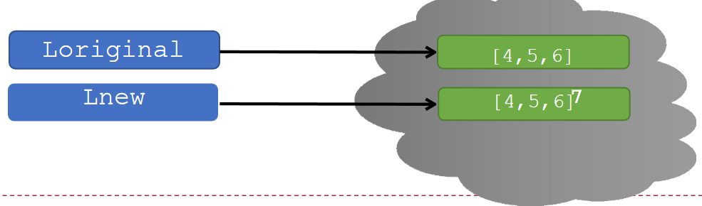
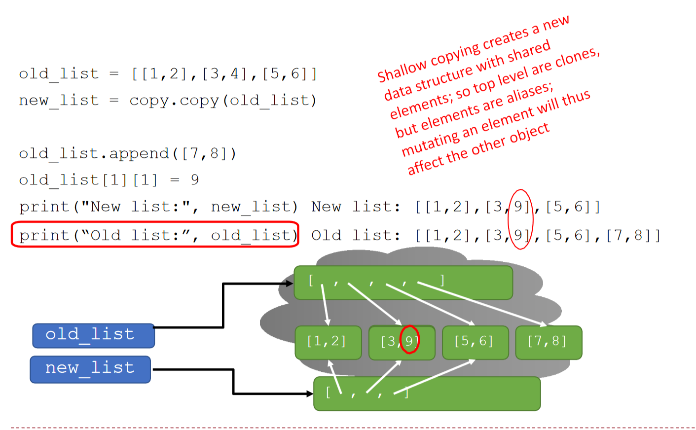
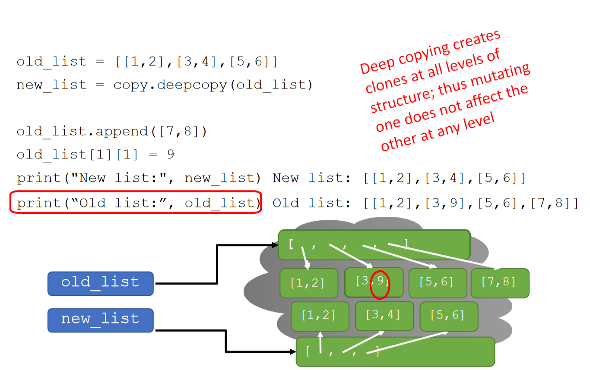

## Homework 2

- 已发布；**截止：2026 年 10 月 20 日 21:00**。

- **Q1 / Q2：函数基础、库存管理**
  - 只提交要求的函数定义，不调用 `input()`，不保留测试代码。

- **Q3 / Q4：打印站模拟、自动售货机**
  - 提交完整程序，严格按照题面要求处理输入和输出。

- 请参考 **26 Fall HW2** 的题面与样例，注意本学期的接口和规则。


<!--s-->

# Functions as Objects


<!--v-->

## Functions as Objects

- 回顾：“Python 中，函数是一等公民”

- 函数可以像其他数据类型一样被传递、赋值和使用

- 示例：灵活折扣系统
  - 定义主函数`apply_discount(price, discount_strategy)`
  - `discount_strategy`是一个函数，计算折扣金额


<!--v-->

### Example: Discount Strategy System

```py
def apply_discount(price, discount_strategy):
    discount = discount_strategy(price)
    final_price = price - discount
    return final_price

# 定义一些折扣策略函数
def fixed_discount(price):
    """固定折扣 - 减 10 元"""
    return 10

def bulk_discount(price):
    """批量折扣 - 满 100 打 8 折，否则 9 折"""
    if price > 100:
        return price * 0.2  # 20% 折扣
    return price * 0.1     # 10% 折扣
```

- Lambda function 是什么？


<!--v-->

## Lambda 表达式：随拿随用的“函数”

假设你正在写代码，需要一个非常简单的函数，比如计算一个数的平方。这个函数你可能只会在这里用一次，之后就再也用不到了。

按照常规方法，你会这样做：

```python
def square(x):
  return x * x

# 然后在需要的地方调用
result = square(5)
print(result) # 输出 25
```

但是这很“小题大做”


<!--v-->

## Lambda 表达式的特点

**Lambda 表达式**允许我们创建**匿名的、小型的、单行的函数**

- **匿名 (Anonymous) 函数：**没有正式名字，不像 `def` 定义的函数那样必须命名
- **小型 (Small)：**设计用来执行简单任务，通常只有一行
- **表达式 (Expression)：**Lambda 本身是一个**表达式**，而不是一个语句
    - 可以作为对象操作：可以在一个列表里定义它，或者作为参数传递给另一个函数，等等
    - 注：由于使用形式与函数类似（如在括号内写参数），其有时也被俗称为“Lambda 函数”，但请注意其本质仍然是表达式


<!--v-->

## Lambda 表达式语法

```python
lambda arguments: expression
```

**`arguments`:** 参数列表，和`def`函数定义中括号里的参数一样。
- **没有参数**: `lambda: "Hello, World!"`
- **一个参数**: `lambda x: x + 10`
- **多个参数**: 用逗号`,`隔开，如 `lambda a, b: a * b`
- 支持一般函数 (`def`) 所支持的参数形式：
    - **默认参数：** `lambda x, y=10: x + y`
    - **可变参数：** `lambda *args: sum(args)`

**`expression`:** 表达式；其计算结果是**此 lambda 表达式的返回值**（即自带 `return` 效果）
- 不需要也不能显式地写 `return` 关键字


<!--v-->

## Lambda 表达式的例子

- **常规函数:**

  ```python
  def add(x, y):
      return x + y
  ```

- **等效的 Lambda 表达式:**

  ```python
  add_lambda = lambda x, y: x + y

  # 调用方式完全一样
  print(add(3, 5))         # 输出 8
  print(add_lambda(3, 5))  # 输出 8

  ```


<!--v-->

### 回到原来的使用示例

```py
original_price = 150.0

# 固定折扣
apply_discount(original_price, fixed_discount) # 进行的计算：150.0 - 10

# 批量折扣
apply_discount(original_price, bulk_discount) # 150.0 - 150.0 * 0.2

# 也可以直接使用 lambda 表达式……
apply_discount(original_price, lambda p: p * 0.15)  # 15% 折扣
```


<!--s-->

# Tuple


<!--v-->

## Tuples（元组）

- 一种新的复合数据类型

- 不可变（immutable）

- 用圆括号`()`表示

- 支持索引、切片、合并、长度、最大/最小值等操作

**Tuples 操作示例**

```python
tuple_empty = ()      # 空元组
tuple_short = (2,)    # 单元素元组需加逗号
hello_tuple = (2, "stu", 3)
hello_tuple[0]   # 2
hello_tuple[1:3] # ("stu", 3)
```


<!--v-->

## 4. 解包与多值返回

元组非常适合用于**变量交换**和**多返回值**函数。

- **变量交换：**
  `(x, y) = (y, x)` （无需额外借助 `temp` 变量）

- **返回多个值：**
  ```python
  def quotient_and_remainder(x, y):
      return (x // y, x % y)
  (quot, rem) = quotient_and_remainder(5, 2)
  ```

- **可变参数 `*args`**
  ```python
  def mean(*args):
      tot = 0
      for a in args:
          tot += a
      return tot / len(args) if len(args) > 0 else 0
  print("计算平均值:", mean(1, 2, 3, 4, 5, 6))
  ```


<!--s-->

# List


<!--v-->

## List (列表)

- 可变（mutable）序列
- 用方括号`[]`表示
- 可包含任意类型元素
- 支持索引、切片、合并、迭代等操作

```python
empty_list = []
hello_list = [2, "a", 4, [1, 2]]
hello_list[0]      # 2
hello_list[3]      # [1, 2]
[1, 2] + [3, 4]    # [1, 2, 3, 4]
```


<!--v-->

## 常用的 List 的方法

- `append(element)`：在末尾添加元素；无返回值 (`None`)

- `sort()`：原地对元素进行排序；无返回值 (`None`)

  - 默认正序；加上可选参数 `reverse=True`为倒序
  - 可指定要参照哪个关键字进行排序；详情查阅 Python 手册

- `reverse()`：原地反向排列元素；无返回值 (`None`)

- `sorted(list)`：返回新排序的列表；**不修改原列表**

**“原地”/“就地”**：对对象本身进行修改


<!--v-->

## Lists 与函数

可传递列表给函数，函数内可修改原列表（副作用）
示例：平方列表中所有元素

```python
def square_list(L):
    for i in range(len(L)):
        L[i] = L[i] ** 2
```


<!--v-->

## 字符串与列表互转

字符串转列表：

- `list(s)`：每个字符作为元素
- `s.split(char)`：以字符 `char` 作为分隔符，进行分割

列表转字符串：

- `'_'.join(L)`：用指定字符连接
  - `''.join(L)`：将列表中的所有元素连成一整个字符串


<!--s-->

# 四、迭代时的修改隐患


<!--v-->

## 1. 危险的操作：边迭代边修改

一个非常常见的错误是：在使用 `for` 循环遍历列表时，同时对其进行 `remove` 或 `append`。

### 思考题：移除所有指定的元素
尝试写一个函数 `remove_all(L, e)` 移除列表中所有的 `e`：

```python
# 错误做法！
def remove_all(L, e):
    for elem in L:
        if elem == e:
            L.remove(e)

L = [1, 2, 2, 2]
remove_all(L, 2)
print(L) # 结果竟是 [1, 2]！
```


<!--v-->

## 2. 为什么会失败？

- Python使用内部计数器跟踪循环的索引。
- 当你移除一个元素时，剩余元素会向左移动填补空缺。
- 但Python**不会**把内部计数器退回一步。
- 结果就是，循环会“跳过”被移到刚刚空缺位置的那个元素！

*正确的做法是使用 `while` 循环，或者遍历列表的副本（比如 `for elem in L[:]`）。*
```python
def remove_all(L, e):
    while e in L:
        L.remove(e)
# 或者
def remove_all(L, e):
    for elem in L[:]:  # 遍历副本
        if elem == e:
            L.remove(e)
```


<!--v-->

## 3. 边迭代边修改的陷阱举例

**无限循环：**
```python
L = [1, 2, 3, 4]
for e in L:
    L.append(0)
    print("这将导致无限循环，因为 L 不断增长，迭代不会结束")
```
由于循环直接跟随着列表元素的增加，它永远也达不到终点，造成死循环！
```python
# range 循环 (安全)
L_range = [1, 2, 3, 4]
for i in range(len(L_range)):
    L_range.append(i)
print("range循环结果:", L_range)
```


<!--s-->

# Aliasing & Cloning (Copying)


<!--v-->

## 1. 内存中的对象

在Python中，修改操作是原地发生的，而赋值可能会创建新对象。
使用 `id(L)` 可以查看对象在内存中的地址。
* `L.append(8)`：`L` 的内存地址不变（可变性）。
* `L = L + [8]`：`L` 指向了一个**全新**的对象。
```python
L = [1, 2, 3]
print(id(L))  # 假设输出 140123456789000
L.append(8)
print(id(L))  # 仍然输出 140123456789000
L = L + [8]
print(id(L))  # 输出一个新的地址，如 140123456789500
```


<!--v-->

## 为什么需要 Copy？

- 赋值语句只是为一个对象**另起**了一个名字（aliasing）

- 对于自身可变的对象，会使目标和对象同时改变
  - 许多情况下会导致意外修改

```py
l1 = [1, 2, 3]
l2 = l1
l2.append(4)
print(l2)  # [1, 2, 3, 4] modified
print(l1)  # [1, 2, 3, 4]
```


<!--v-->

### 回顾：函数传入可变对象

- 场景：函数可能对传入的参数进行修改
  - 若传入了可变对象，函数对参数进行的修改将直接影响其原始对象

```py
def foo(l2):
    print("Id of l2 before revised:", id(l2))
    l2.append(4)
    print("Id of l2 after revised:", id(l2)) # same

l1 = [1, 2, 3]
print("Id of l1:", id(l1))
foo(l1)
print(l1) # [1, 2, 3, 4]
```


<!--v-->

## 对一个列表进行 Copy

改变生成的副本不会影响原始对象

`l2 = l1[:]`，或 `import copy` 后 `l2 = copy.copy(l1)`

- 等价于：创建空列表 `l2` - 遍历 `l1`，将 `l1` 的每个元素依次 `append` 进 `l2`

```py[]
l1 = [4, 5, 6]
l2 = l1[:]
l2.append(7)
print(l2)  # [4, 5, 6, 7]
print(l1)  # [4, 5, 6]
```




<!--v-->

## 有嵌套的可变对象：避免 Shallow Copy

- 上述 `l2 = l1[:]` 和 `l2 = copy.copy(l1)` 都属于浅拷贝（Shallow Copy）
- 浅拷贝 **仅拷贝嵌套的第一层** ，第二层或更深（例如其中的可变对象）不会被拷贝




<!--v-->

## 有嵌套的可变对象：Deep Copy

- 当嵌套结构中的元素可能是可变对象时，使用**深拷贝** - 确保每个嵌套层级的每个结构都被复制
  


<!--v-->

## 更多例子

```py
import copy
orig = ['Hi, I am ', list('Bob')]
alias = orig
shallow = orig.copy()
deep = copy.deepcopy(orig)
orig[0] = 'Hi, he is'
orig[1][0] = 'C'
print(orig, alias, shallow, deep, sep='\n')
```

What should be the output?


<!--v-->

## 更多例子

```text
['Hi, he is', ['C', 'o', 'b']]
['Hi, he is', ['C', 'o', 'b']]
['Hi, I am ', ['C', 'o', 'b']]
['Hi, I am ', ['B', 'o', 'b']]
```
